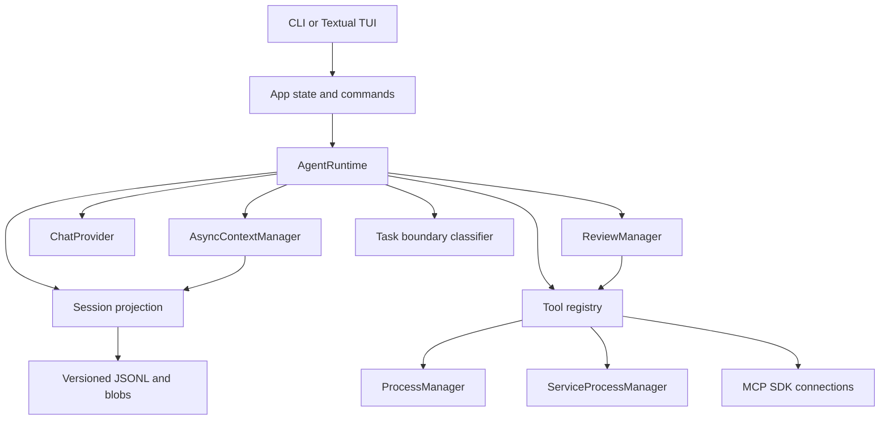
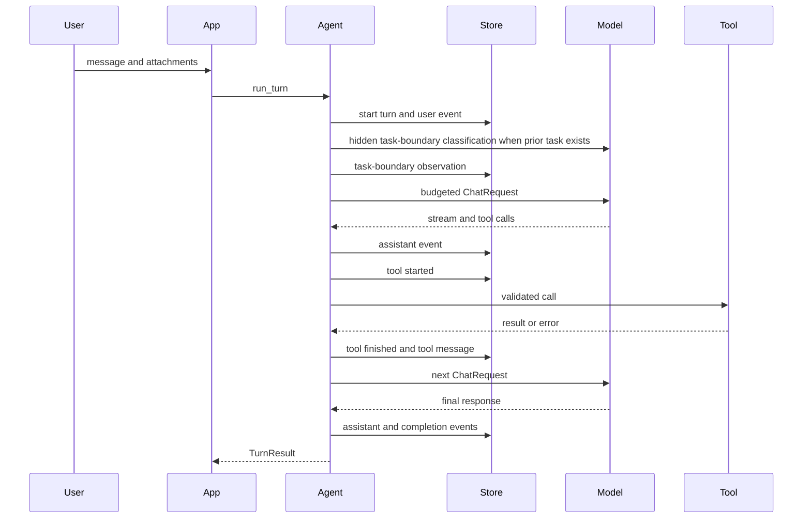
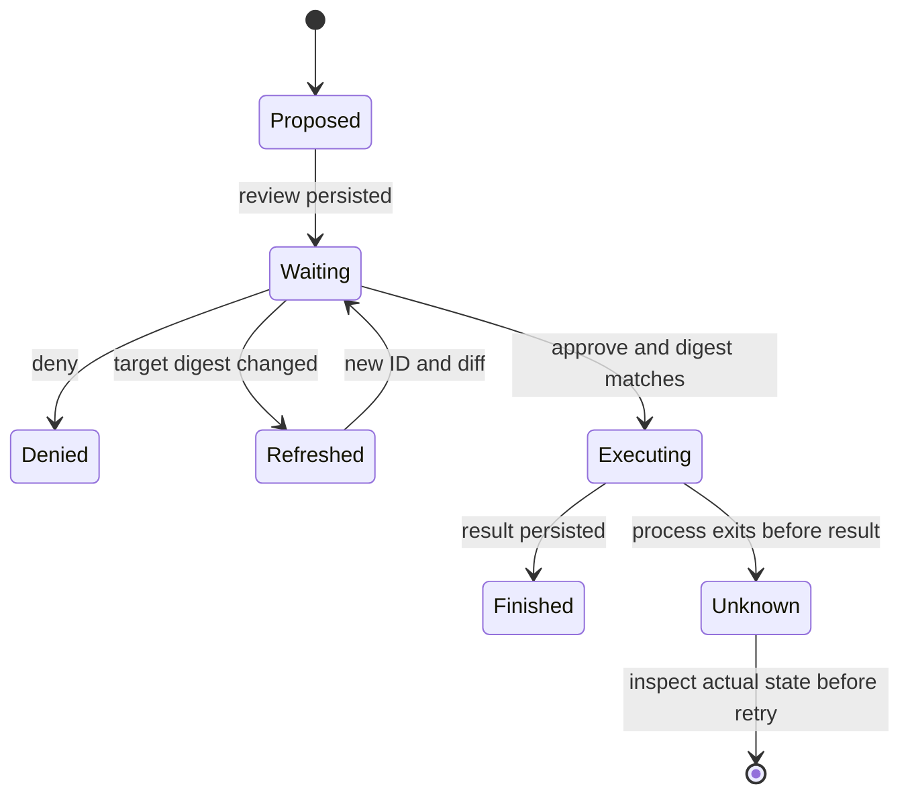

# CodeRill architecture and failure semantics

CodeRill's production entry points are `coderill/app/cli.py` and `coderill/app/tui.py`. Both assemble `AgentRuntime` through `app/factory.py` and `app/state.py`. Python callers also use the async runtime.

## Contracts and boundaries

- `providers/types.py` defines requests, messages, tool calls, tool results, stream events, usage, and capability flags. OpenAI compatible and Anthropic adapters translate SDK data at this boundary.
- `AgentRuntime.run_turn`, `resume_turn`, and `cancel_turn` drive one async model/tool loop. A request ends as complete, waiting for review, cancelled, failed, or over budget. The runtime pairs every observed tool call with a tool message before the next model request.
- `SessionStore` writes versioned events; `project_events` reconstructs state without mutating those events; `Session` handles lifecycle and commands. New events use v2; v1 logs remain readable. A final incomplete JSONL line can be recovered; a corrupt middle line is an error. One session driver holds a process lock while a turn runs.
- `ReviewManager` creates the review ID, original arguments, workspace targets, digests, and diff. The UI submits only the ID and choice. A changed target generates a fresh review before execution. Multi-file patches and deletion always require review outside bypass mode. Saved grants are scoped to workspace and exact shell command or file target.
- `AsyncContextManager` estimates the full request, including system text, tool declarations, attachments, and output reserve. Its L1–L4 pipeline trims old dialogue, compresses old tool output by content type, archives remaining large output, and checkpoints older turns. Exact source text remains retrievable; failed or unhelpful compression stops rather than looping indefinitely.
- The hidden task-boundary call proposes `same`, `new`, or `uncertain`; `Session.observe_task` owns the stable hash and two-observation transition. Context uses a confirmed transition as a safe old-task checkpoint boundary. A failed classification becomes `uncertain` and never blocks the user turn.
- Old successful reads followed by successful writes to the same normalized path are marked stale in the model view. Old tool output keeps type-specific clues for JSON, diffs, errors, and search hits, with exact content in the archive. External file edits are outside this event-based detection.
- `MCPToolSearch` searches connected tools locally. The initial request contains its schema, while remote schemas appear only after activation; `AgentRuntime` rejects a guessed inactive MCP call. Skill bodies are pinned into session assets on first drive and remain stable after restart.
- `mcp_tool_search` and `skill_search` rank names and descriptions locally, with optional user-configured embeddings. Search exposes candidates; execution and approval remain in the existing runtime. Routing observations and per-model token counts are append-only session events, so old events retain an unknown-model cost rather than being attributed to the current model.
- `ProcessManager` bounds one-shot command time and output. `ServiceProcessManager` starts long-running commands with session logs and explicit status/stop tools; detached processes keep readable logs but cannot be stopped by stale PID alone. `SubagentService` uses an independent session and budget; writable children work in a Git worktree and their diff requires an explicit apply. Background results are collected before a model request, with the notification and one-time marker in one event. A linked plan task is completed only after a successful child result and revision checks; one extra model request can reconcile an unfinished plan before the final answer.

## Why these layers are separate

| Layer | Reason for the boundary | How to verify |
| --- | --- | --- |
| `app` | CLI, TUI, and headless callers must agree on approval and stop semantics. | Follow `State.rebuild` into `AgentRuntime`; TUI buttons submit review ID and choice. |
| `agent` | The order of model calls, tool calls, budget checks, and recovery is one state machine. | Trace `_drive` and the paired `tool_started` / `tool_finished` events. |
| `providers` | Vendor SDK messages and stream chunks differ while the loop's contract should remain stable. | Compare both adapters against `providers/types.py` and the shared contract tests. |
| `context` | The model needs a bounded view, while the audit log must keep exact prior facts. | Show a checkpoint, an archive ID, and `archive_read` recovering the original. |
| `session` | Restart must reconstruct what is known, including pending review and unknown side effects. | Replay JSONL through `project_events` and run the failure demo. |
| `permissions` | A model's proposed action is not user approval. | Modify the target after review and show a fresh diff and ID. |
| `tools` and `runtime` | Tool schemas describe operations; process cancellation and execution limits are shared mechanisms. | Compare a one-shot `bash` timeout with a logged long-running process. |
| `planning`, `skills`, `mcp` | Plan state, workflow instructions, and external capabilities have different lifecycles. | Show revision rejection, pinned Skill text, and MCP schema activation. |

## One request

## Approval and restart

The log records what CodeRill knows. It cannot guarantee that an external command ran exactly once if the process exits between an external side effect and a durable result. On replay, an unfinished call becomes `unknown` and is never automatically reissued. Similarly, a Git worktree isolates a directory, not the operating system or the shell command's reach.

## Verification map

| Behavior | Code | Offline check |
| --- | --- | --- |
| Provider contract and errors | `providers/` | `tests/test_provider_contract.py` |
| Approval refresh and replay | `agent/runtime.py`, `permissions/review.py` | `tests/test_runtime.py`, `examples/failure_demo.py` |
| JSONL tail, locking, legacy decoding | `session/` | `tests/test_session.py` |
| Compression and retrieval | `context/builder.py`, `context/pipeline.py`, `tools/archive.py` | `tests/test_context_builder.py` |
| Task boundary and budgets | `agent/runtime.py`, `session/model.py` | `tests/test_runtime.py` |
| Skill version and MCP selection | `skills.py`, `mcp.py` | `tests/test_skills.py`, `tests/test_mcp_sdk.py` |
| Shell timeout and cancellation | `runtime/process.py` | `tests/test_process_runtime.py` |
| Long-running process logs | `runtime/services.py`, `tools/services.py` | `tests/test_services.py` |
| Background and subagent boundaries | `runtime/background.py`, `agent/subagents.py` | `tests/test_background.py`, `tests/test_subagents.py` |
| CLI/TUI shared runner | `app/` | `tests/test_tui.py`, `tests/test_runtime.py` |
| Dependency direction and import effects | core packages | `tests/test_architecture.py` |

Real provider, MCP server, and browser behavior needs explicit integration runs. The offline tests exercise adapters with fake SDK clients and browser logic with fakes. The browser reader's source notice remains in `coderill/browser_NOTICE.txt`.

